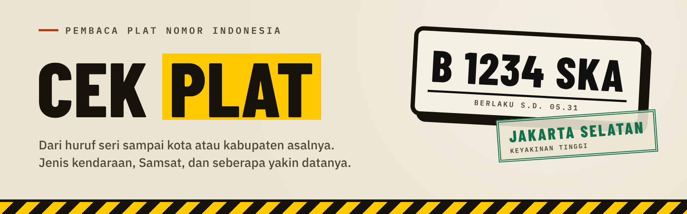
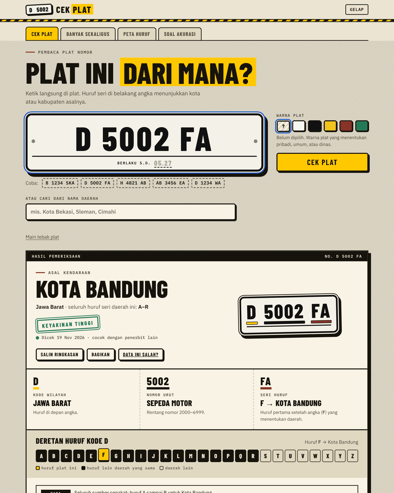

<p align="center">
  
</p>

<p align="center"><a href="README.md">Bahasa Indonesia</a> &nbsp;·&nbsp; <b>English</b></p>

<p align="center">
  <a href="https://github.com/baska-pro/plat/actions/workflows/pages.yml"></a>
  <a href="LICENSE"></a>
  
</p>

CekPlat reads an Indonesian vehicle licence plate down to the **city or regency** it was issued in. Type `B 1234 SKA` and the answer is not just "Greater Jakarta" but **South Jakarta**. Type `D 5002 FA` and you get **Bandung City**.

Everything runs in the browser. No server, no account, and the plate you type is never sent anywhere. The interface is in Indonesian.

<p align="center">
  
</p>

## How a plate is read

```
D   5002   FA
│    │     └─ FIRST letter of the series (F) -> area of issue: Bandung City
│    └─ serial number -> vehicle class (2000-6999 = motorcycle)
└─ region code -> province
```

The first letter after the digits decides the city or regency.

## Features

- **Type straight into the plate.** Results appear as you type; plate colour tells private, commercial, and government vehicles apart.
- **Letter-level map** for 57 of 60 region codes (more than 450 areas). `PS`, `PT`, and `PY`, the new 2024 Papua codes, are still province-level.
- **Confidence stamp** on every result (high, medium, ambiguous, province-level), plus the date checked and how the code compares with other publishers.
- **Reverse search:** type "Cimahi" and learn the code is `D` with letters `S` and `T`.
- **Bulk mode:** paste up to 500 plates, copy to Excel or download CSV.
- **Guess the plate:** a 10-question quiz that only uses high-confidence data.
- **Official tax channels:** links to SIGNAL (national) and each province's Bapenda site. CekPlat itself never looks at vehicle or tax records.
- **Open data:** the whole table as [`data/plat.json`](docs/DATA.md) with a JSON Schema.
- Light and dark themes, responsive from phone to desktop, installable as a PWA and works offline.

## Run it

No build step. Node 18 or newer:

```bash
git clone https://github.com/baska-pro/plat.git
cd plat
npm start        # http://localhost:8080
```

```bash
npm install && npx playwright install chromium   # once
npm test                                         # 55 unit tests
npm run test:ui                                  # 29 UI tests incl. WCAG AA checks (axe-core)
npm run lint
```

## How accurate is it?

No official Polri or Samsat document publishes which series letter belongs to which city. The data is compiled from public tables, and each region code is then cross-checked against other publishers. Every result carries a confidence level:

| Level | Meaning |
|---|---|
| **High** | Matches at least one other source, with no source disagreeing for that letter |
| **Medium** | A single source, or most sources agree against one outlier |
| **Ambiguous** | Sources conflict, or one letter is listed for several areas |
| **Province-level** | Only the province can be determined |

"Matches" only means **no other table contradicts it**. It is neither official nor independent proof, because several publishers appear to quote each other. For legal or administrative matters, ask the local Samsat or Bapenda.

Details (conflicts found, codes with no comparison, full source list, in Indonesian) are in **[docs/AKURASI.md](docs/AKURASI.md)**. Spotted a wrong entry? Use the **Data ini salah?** ("Is this wrong?") button in the app or [open an issue](https://github.com/baska-pro/plat/issues/new?template=koreksi-data.yml).

## Contributing

Data corrections with a source are the most useful contribution. See [CONTRIBUTING.md](CONTRIBUTING.md) (Indonesian). Security reports: [SECURITY.md](SECURITY.md). Release history: [CHANGELOG.md](CHANGELOG.md).

## Licence

Code: [MIT](LICENSE), copyright &copy; 2026 Lathif Baska. The Barlow Condensed and IBM Plex fonts are under the SIL OFL 1.1 (`fonts/LICENSE-OFL.txt`). Region data comes from third-party publications (see [docs/AKURASI.md](docs/AKURASI.md#sumber)).

CekPlat is not an official service of Polri, Korlantas, Samsat, or Bapenda.
