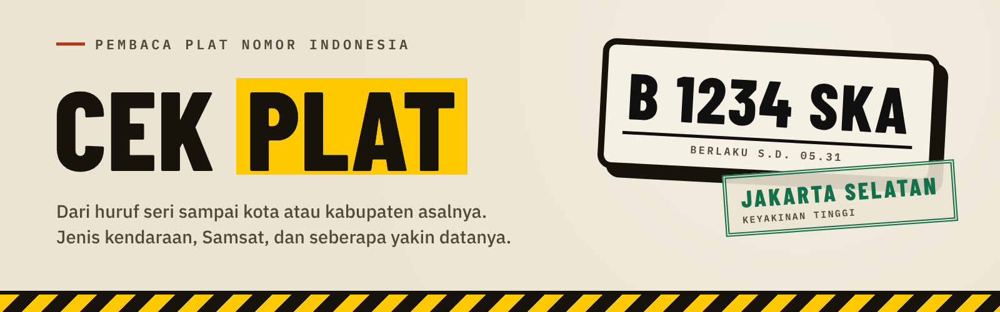
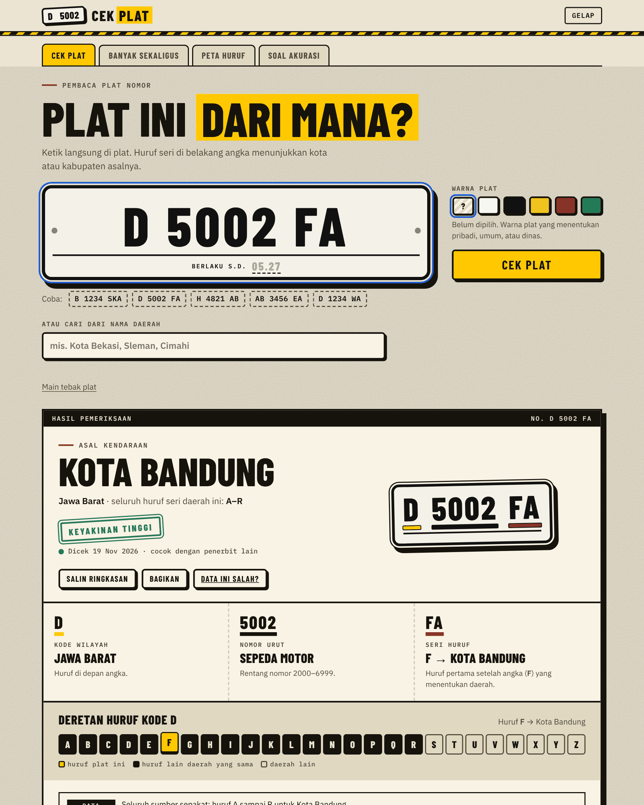
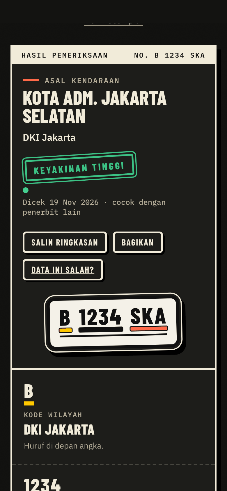
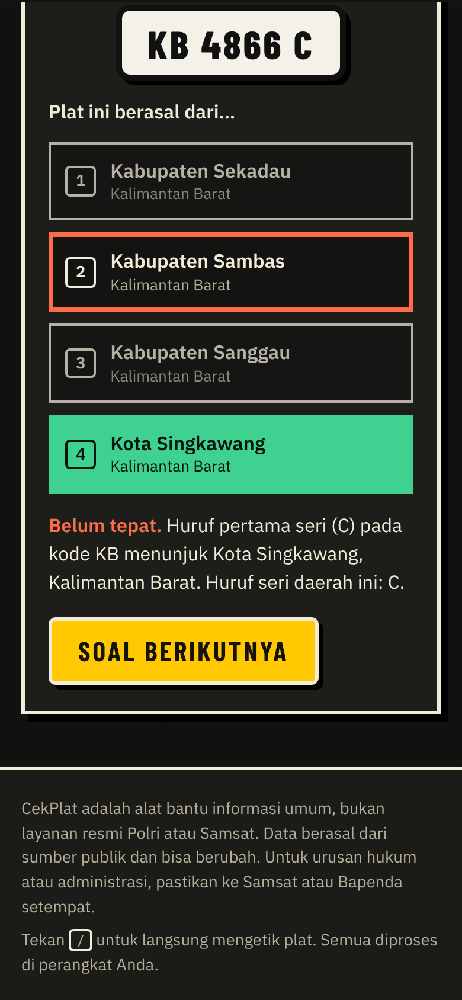
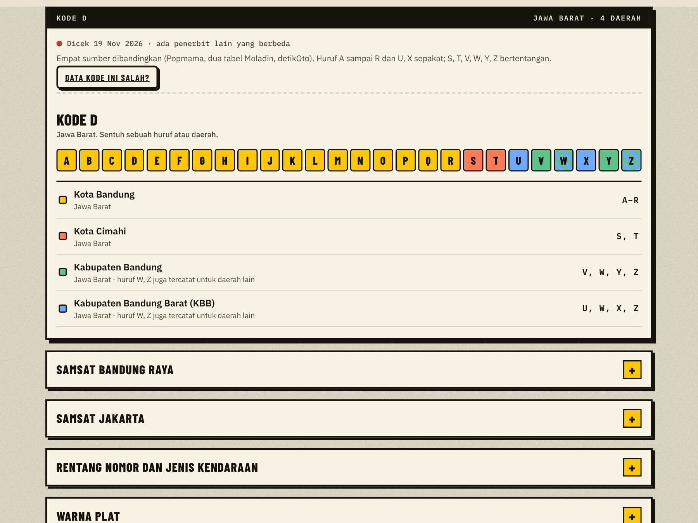

<p align="center">
  
</p>

<p align="center">
  <a href="https://github.com/baska-pro/plat/actions/workflows/pages.yml"></a>
  <a href="LICENSE"></a>
  
</p>

CekPlat membaca plat nomor kendaraan Indonesia sampai tingkat **kota atau kabupaten**. Ketik `B 1234 SKA` dan hasilnya bukan sekadar "Jakarta dan sekitarnya", melainkan **Kota Adm. Jakarta Selatan**. Ketik `D 5002 FA` dan hasilnya **Kota Bandung**.

Semuanya berjalan di browser. Tidak ada server, tidak ada akun, dan nomor plat yang diketik tidak dikirim ke mana pun.

<p align="center">
  
</p>

## Cara membaca plat

```
D   5002   FA
│    │     └─ huruf PERTAMA seri (F) -> daerah asal: Kota Bandung
│    └─ nomor urut -> jenis kendaraan (2000-6999 = sepeda motor)
└─ kode wilayah -> provinsi
```

Contoh hasil:

| Plat | Hasil |
|---|---|
| `B 1234 SKA` | Kota Adm. Jakarta Selatan, DKI Jakarta |
| `B 1234 KKA` | Kota Bekasi, Jawa Barat |
| `B 1234 EKA` | Kota Depok, Jawa Barat |
| `B 1234 WKA` | Kota Tangerang Selatan, Banten |
| `D 5002 FA` | Kota Bandung, Jawa Barat |
| `H 4821 AB` | Kota Semarang, Jawa Tengah |
| `AB 3456 EA` | Kabupaten Sleman, DI Yogyakarta |
| `D 1234 WA` | **Kabupaten Bandung atau Kabupaten Bandung Barat** (ambigu, lihat di bawah) |

## Tampilan

<p align="center">
  
  &nbsp;
  
</p>
<p align="center">
  
</p>

## Fitur

- **Ketik langsung di plat**: hasil muncul saat mengetik; warna plat bisa dipilih (putih, kuning, merah, hijau, hitam) untuk menentukan pribadi/umum/dinas
- **Pembaca tiga bagian**: kode wilayah, nomor urut, dan seri huruf dijelaskan satu per satu, dengan deretan tuts A-Z yang menyorot huruf Anda dan huruf lain milik daerah yang sama
- **Cap tingkat keyakinan** di setiap hasil (tinggi / sedang / ambigu / tingkat provinsi), plus **tanggal cek**, status perbandingan, dan tautan ke artikel pembanding
- **Tombol "Data ini salah?"** di hasil dan di Peta huruf: membuka formulir GitHub Issue dengan kode dan huruf sudah terisi (nomor plat lengkap tidak ikut dikirim)
- **Peta huruf**: pilih kode untuk melihat huruf apa milik daerah mana, atau **cari balik**: ketik "Cimahi" untuk tahu kodenya `D` dengan huruf `S, T`
- **Cari dari nama daerah** langsung di halaman utama: ketik "Kota Bekasi" atau "Sleman", lihat kode dan hurufnya, ketuk untuk membukanya di Peta huruf
- **Tebak plat**: kuis 10 soal, empat pilihan, skor terbaik tersimpan lokal. Soal hanya memakai huruf berkeyakinan tinggi dan satu daerah, jadi jawaban "benar" tidak pernah berasal dari data yang diperdebatkan
- **Kanal resmi cek pajak** di setiap hasil: tautan ke SIGNAL (Samsat Digital Nasional) dan situs/aplikasi Bapenda provinsi terkait. CekPlat sendiri tidak melihat data kendaraan atau pajak
- **Banyak sekaligus**: tempel hingga 500 plat, salin ke Excel atau unduh CSV
- Samsat Bandung Raya (alamat, telepon, jam layanan, tombol peta dan telepon) dan Samsat Jakarta (induk dan gerai; alamat saja), masa berlaku plat `BB.TT`, riwayat, tautan yang bisa dibagikan (`?plat=B+1234+SKA`)
- Terang/gelap, responsif dari ponsel sampai desktop, bisa diinstal (PWA) dan jalan offline
- Tanpa framework, tanpa dependensi saat berjalan (Playwright hanya untuk tes), font di-host sendiri; semua diproses di browser, tidak ada data dikirim ke mana pun

## Menjalankan

Tidak perlu build. Cukup Node 18 ke atas:

```bash
git clone https://github.com/baska-pro/plat.git
cd plat
npm start        # http://localhost:8080
```

Tes:

```bash
npm test                                           # 53 tes unit: parser, data, verifikasi, kuis
npm install && npx playwright install chromium     # sekali saja
npm run test:ui                                    # 13 skenario UI di Chromium
```

Situs statis ini bisa di-host di mana saja. Workflow di `.github/workflows/pages.yml` menjalankan kedua tes lalu men-deploy ke GitHub Pages (Settings > Pages > Source: GitHub Actions).

## Seberapa akurat

Tidak ada dokumen atau API resmi Polri maupun Samsat yang menerbitkan pembagian huruf seri ke kota/kabupaten. Datanya dikumpulkan dari tabel publik, lalu setiap kode dibandingkan dengan artikel penerbit lain. Setiap hasil membawa cap keyakinan:

| Cap | Arti |
|---|---|
| **Tinggi** | Cocok dengan minimal satu sumber lain, tanpa yang bertentangan untuk huruf itu |
| **Sedang** | Satu sumber saja, atau mayoritas sumber sepakat dengan satu yang berbeda |
| **Ambigu** | Sumber bertentangan, atau satu huruf tercatat untuk beberapa daerah |
| **Tingkat provinsi** | Hanya provinsinya yang bisa ditentukan |

"Cocok" berarti **tidak ada tabel lain yang bertentangan**. Itu bukan data resmi dan bukan bukti independen, karena beberapa penerbit terlihat saling mengutip. Untuk urusan hukum atau administrasi, tanyakan ke Samsat atau Bapenda setempat.

Rinciannya (konflik yang ditemukan, kode tanpa pembanding, daftar sumber) ada di **[docs/AKURASI.md](docs/AKURASI.md)**. Kalau menemukan data yang salah, pakai tombol **Data ini salah?** di aplikasi atau [buka issue](https://github.com/baska-pro/plat/issues/new?template=koreksi-data.yml). Cara memperbaikinya sendiri ada di [CONTRIBUTING.md](CONTRIBUTING.md).

## Struktur

```
index.html            halaman
css/style.css         gaya ("loket registrasi": kertas, tinta, bayangan keras; mode gelap = aspal)
fonts/                Barlow Condensed, IBM Plex Sans/Mono (SIL OFL, di-host sendiri)
js/series.js          tabel huruf seri -> daerah untuk 55 kode (diedit di sini)
js/quiz.js            kuis tebak plat (hanya huruf berkeyakinan tinggi)
js/verify.js          hasil verifikasi silang: status, tanggal cek, tautan pembanding, huruf diperdebatkan
js/data.js            plat D, Samsat, warna, kode wilayah, sumber, pencarian
js/parser.js          logika parsing plat (bisa dipakai di Node)
js/app.js             antarmuka
sw.js, manifest...    PWA / offline
tests/                53 tes unit (node:test)
tests/ui/             13 tes antarmuka (Playwright)
.github/ISSUE_TEMPLATE/  formulir koreksi data (dipakai tombol "Data ini salah?")
scripts/serve.js      server statis lokal
docs/                 catatan akurasi dan gambar untuk README
```

## Berkontribusi

Koreksi data paling berguna, terutama kalau Anda punya sumber resmi. Lihat [CONTRIBUTING.md](CONTRIBUTING.md). Laporan keamanan: [SECURITY.md](SECURITY.md).

## Lisensi

Kode: [MIT](LICENSE), hak cipta &copy; 2026 Lathif Baska. Font Barlow Condensed dan IBM Plex dilisensikan SIL OFL 1.1 (`fonts/LICENSE-OFL.txt`). Data wilayah bersumber dari publikasi pihak lain (lihat [docs/AKURASI.md](docs/AKURASI.md#sumber)).

CekPlat bukan layanan resmi Polri, Korlantas, Samsat, atau Bapenda.
